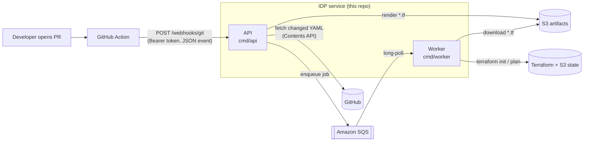

# IDP Infra — Self-Service Infrastructure from a Pull Request

[](https://github.com/abraam31/idp-loc-infra/actions/workflows/ci.yml)


[](LICENSE)

The backend of a small **Internal Developer Platform (IDP)**. Developers describe the AWS
infrastructure they need in a short YAML file inside their app repo. When they open a pull
request, a GitHub Action calls this service, which turns the YAML into Terraform, queues
a job, and runs `terraform plan` on a worker.

The goal: developers ask for infrastructure in a few lines of YAML, and the platform team
keeps control of the Terraform modules, state and credentials.

```yaml
# infra/environment.yaml (in the developer's repo)
env: staging
aws:
  lb:
    - name: public-api
      type: application
      subnets: [subnet-0aaa1111, subnet-0bbb2222]
      health-check-type: HTTP
      health-check-port: 8080
```

⬇️ becomes ⬇️

```hcl
module "public-api" {
<<<<<<< CURRENT (yours)
  source            = "git@github.com:your-org/terraform-modules.git//alb?ref=master"
=======
  source            = "git::https://github.com/abraam31/terraform-modules.git//alb?ref=main"
>>>>>>> PROPOSED (Claude)
  name              = "public-api"
  subnets           = ["subnet-0aaa1111", "subnet-0bbb2222"]
  health_check_path = "HTTP:8080"
}
```

…plus a generated `backend.tf` (S3 remote state per environment and job) and `providers.tf`.

## Architecture



| Component | What it does |
|---|---|
| **API** (`cmd/api`) | Authenticated webhook endpoint. Reads the PR event, fetches the changed `*.yaml` files from GitHub, checks the spec, resolves per-environment settings (region, state bucket), renders Terraform files, uploads them to S3 and puts a job on SQS. |
| **Worker** (`cmd/worker`) | Long-polls SQS, downloads the job's Terraform files from S3 if they aren't local, runs `terraform init` + `plan` (or `apply`), and saves the logs and plan output for each job. Deletes the SQS message only after the job succeeds, so failed jobs are retried. |
| **Queue** (`internal/queue`) | A small wrapper around SQS with a job envelope, plus a filesystem queue for local development. |

### Design highlights

- **API and worker are decoupled through SQS**: the webhook returns `202 Accepted` right away, and slow Terraform runs never block GitHub.
- **Source-aware file fetching**: the `github` source uses the GitHub Contents API pinned to the PR's commit SHA. The `local` source reads from a mock repo for offline testing. `auto` tries GitHub first, then the local repo.
- **Isolated state per job**: each job gets its own S3 backend key (`<env>/<job-id>/terraform.tfstate`), with encryption turned on.
- **Production-minded containers**: multi-stage builds. The API runs on distroless as non-root. The worker image ships pinned `terraform` and `git` and also runs as non-root.
- **Operational basics**: `/healthz`, `/readyz`, `/version`, request IDs, structured log lines, graceful shutdown.
- **CI/CD**: GitHub Actions runs gofmt, vet, race-enabled tests and Docker builds on every PR. A separate release workflow builds the images and pushes them to Amazon ECR.

## API

| Method | Path | Description |
|---|---|---|
| `POST` | `/webhooks/git` | Submit a job. Needs `Authorization: Bearer $IDP_API_TOKEN`. Accepts a **JSON PR event** ([example](examples/webhook-event.json)) or **raw YAML** ([example](examples/environment.yaml)) for manual testing. Returns `202` with the job description. |
| `GET` | `/healthz` · `/readyz` | Liveness / readiness |
| `GET` | `/version` | Build version |

## Quick start

**Requirements:** Go 1.24+, Docker, and an AWS account with an SQS queue (and optionally an S3 bucket).

```bash
make test           # unit tests
make build          # -> bin/api, bin/worker
make docker-build   # -> idp-api:local, idp-worker:local
```

Run the API and submit a spec:

```bash
export SQS_QUEUE_URL=https://sqs.us-east-1.amazonaws.com/<account>/<queue>
export IDP_API_TOKEN=devtoken
export ARTIFACTS_DIR=./artifacts
make run-api

curl -X POST localhost:8080/webhooks/git \
  -H "Authorization: Bearer devtoken" \
  --data-binary @examples/environment.yaml
```

Run the worker in another terminal (it needs `terraform` on `PATH`, or use the Docker image):

```bash
SQS_QUEUE_URL=... ARTIFACTS_DIR=./artifacts make run-worker
```

## Configuration

| Variable | Used by | Default | Description |
|---|---|---|---|
| `SQS_QUEUE_URL` | api, worker | — (**required**) | Job queue |
| `IDP_API_TOKEN` | api | — (**required**) | Bearer token for the webhook |
| `AWS_REGION` | api, worker | `us-east-1` | AWS region |
| `API_ADDR` | api | `:8080` | Listen address |
| `ARTIFACTS_BUCKET` | api | *(disabled)* | S3 bucket for rendered Terraform. Needed when the API and worker don't share a disk. |
| `ARTIFACTS_PREFIX` | api | `jobs` | S3 key prefix |
| `ARTIFACTS_DIR` | api, worker | `/app/artifacts` | Local working directory |
| `TF_RENDER_DIR` | api | `$ARTIFACTS_DIR/jobs` | Where rendered Terraform files are written |
| `TF_RESULTS_DIR` | worker | `$ARTIFACTS_DIR/results` | Where plan/apply logs are written |
<<<<<<< CURRENT (yours)
| `TF_MODULE_REPO` | api | `git@github.com:your-org/terraform-modules.git` | Source repo for Terraform modules |
=======
| `TF_MODULE_REPO` | api | `git::https://github.com/abraam31/terraform-modules.git` | Source repo for Terraform modules ([abraam31/terraform-modules](https://github.com/abraam31/terraform-modules)) |
>>>>>>> PROPOSED (Claude)
| `GITHUB_TOKEN` | api | *(disabled)* | Turns on fetching from GitHub |
| `GITHUB_API_BASE_URL` | api | `https://api.github.com` | For GitHub Enterprise |
| `MOCK_REPO_ROOT` | api | `./mock-repo` | Root folder for `source: local` |

## Project layout

```
cmd/api/          HTTP API: webhook handling, YAML → Terraform rendering, S3 upload, enqueue
cmd/worker/       SQS consumer that runs terraform plan/apply
internal/queue/   SQS queue and local filesystem queue
internal/config/  Config helpers
internal/types/   Spec types
examples/         Sample spec and webhook payload
.github/workflows CI (lint/test/build) and ECR release
```

## Roadmap

- [ ] Post the `terraform plan` output back to the PR as a comment
- [ ] Run `apply` when the PR is merged, with an approval gate
- [ ] Typed, versioned spec with JSON Schema validation
- [ ] More resource types (RDS, S3, SQS, IAM roles)
- [ ] Policy checks (OPA) before planning
- [ ] Helm chart for running on Kubernetes

## License

[MIT](LICENSE)
